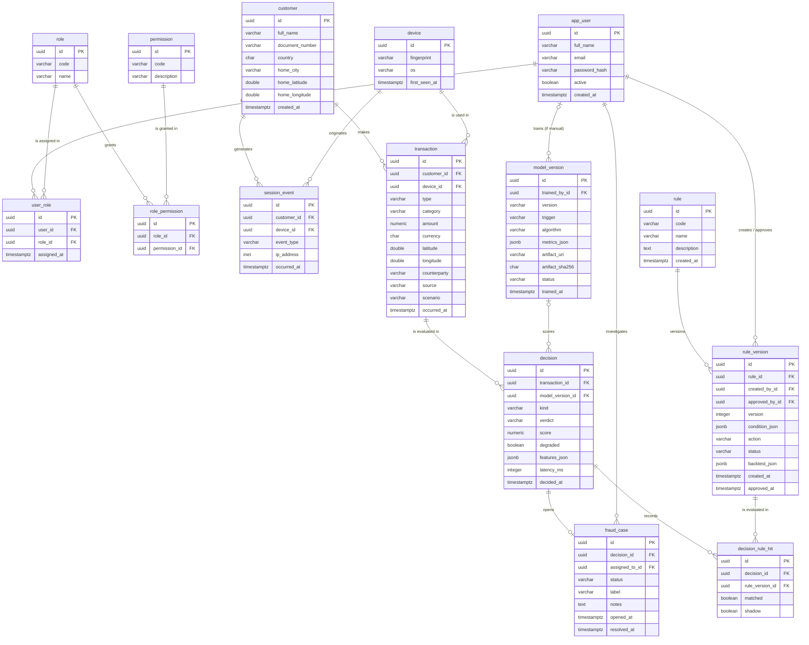

# MonedaSegura — data model (ERD)

Single source of truth for the relational model of the `decision-service` (PostgreSQL). The SVG `docs/erd.svg` is generated from this file with the `erd-svg` skill; to change a table, change this file first.

Where the data comes from: see `docs/data.md` (seed from the colombianized Sparkov dataset + simulator).

Deliberately outside the ERD:
- **Redis** holds a fast view of per-customer features (windowed counters). It is a derived cache; the source of truth is `transaction` and `session_event`.
- **Kafka** carries events (`decisions` topic); it is not model storage.
- **Model files** live in object storage (SeaweedFS with the S3 API, bucket `models`), written only by the `scoring-service`. This database holds their registry (`model_version`), which points to each file through `artifact_uri`.

## 1. Diagram (Mermaid)



## 2. Tables

### Access (RBAC)
Classic RBAC: a user has roles and a role has permissions. Code **never checks a role**, only a permission (`hasAuthority('RULE_APPROVE')`), so reassigning permissions never requires a code change.

| Table | Attribute | Type | Notes |
|---|---|---|---|
| `app_user` | `id` | uuid | PK |
| | `full_name` | varchar(120) | |
| | `email` | varchar(160) | unique |
| | `password_hash` | varchar(100) | BCrypt; never plain text |
| | `active` | boolean | deactivate instead of delete |
| | `created_at` | timestamptz | |
| `role` | `id` | uuid | PK |
| | `code` | varchar(40) | unique; see catalog below |
| | `name` | varchar(80) | |
| `permission` | `id` | uuid | PK |
| | `code` | varchar(60) | unique; see catalog below |
| | `description` | varchar(200) | |
| `user_role` | `id` | uuid | PK |
| | `user_id` | uuid | FK → `app_user.id` |
| | `role_id` | uuid | FK → `role.id`; unique (`user_id`, `role_id`) |
| | `assigned_at` | timestamptz | |
| `role_permission` | `id` | uuid | PK |
| | `role_id` | uuid | FK → `role.id` |
| | `permission_id` | uuid | FK → `permission.id`; unique (`role_id`, `permission_id`) |

### Customers and events (synthetic data)
| Table | Attribute | Type | Notes |
|---|---|---|---|
| `customer` | `id` | uuid | PK |
| | `full_name` | varchar(120) | shown masked in the app |
| | `document_number` | varchar(20) | shown masked (`****4821`) |
| | `country` | char(2) | MVP: `CO` only (default). Kept to grow to PE/MX |
| | `home_city` | varchar(80) | usual city |
| | `home_latitude` | double precision | home coordinates; basis of the distance feature and of the simulator's "impossible travel" |
| | `home_longitude` | double precision | |
| | `created_at` | timestamptz | account age (origination fraud) |
| `device` | `id` | uuid | PK |
| | `fingerprint` | varchar(64) | unique; external provider fingerprint (simulated) |
| | `os` | varchar(20) | `ANDROID`, `IOS` |
| | `first_seen_at` | timestamptz | |
| `session_event` | `id` | uuid | PK |
| | `customer_id` | uuid | FK → `customer.id` |
| | `device_id` | uuid | FK → `device.id` |
| | `event_type` | varchar(30) | `LOGIN_OK`, `LOGIN_FAILED`, `PASSWORD_CHANGED`, `DEVICE_REGISTERED` |
| | `ip_address` | inet | |
| | `occurred_at` | timestamptz | index (`customer_id`, `occurred_at`) |
| `transaction` | `id` | uuid | PK |
| | `customer_id` | uuid | FK → `customer.id` |
| | `device_id` | uuid | FK → `device.id` |
| | `type` | varchar(20) | `DEBIT`, `CREDIT`, `TRANSFER`, `BALANCE_QUERY` |
| | `category` | varchar(30) | merchant category (Sparkov's: `shopping_net`, `grocery_pos`, `gas_transport`…); strong feature |
| | `amount` | numeric(14,2) | |
| | `currency` | char(3) | MVP: `COP` only (default). Rule thresholds are in COP |
| | `latitude` | double precision | |
| | `longitude` | double precision | |
| | `counterparty` | varchar(120) | merchant or destination account |
| | `source` | varchar(20) | `SEED_DATASET` (loaded from Sparkov) or `SIMULATOR` (generated live) |
| | `scenario` | varchar(20) | known ground truth: `NORMAL`, `DATASET_FRAUD` (Sparkov card fraud), `CARD_FRAUD` (simulated card fraud), `ORIGINATION`, `ATO`; **never** sent to the model as a feature, only used as a training label and for measuring |
| | `occurred_at` | timestamptz | index (`customer_id`, `occurred_at`) |

The customer–device relationship has no table of its own: it is derived from `transaction` and `session_event` (features `is_new_device`, `customers_on_device`).

### Decision and model
| Table | Attribute | Type | Notes |
|---|---|---|---|
| `decision` | `id` | uuid | PK |
| | `transaction_id` | uuid | FK → `transaction.id`. `BALANCE_QUERY` transactions are not evaluated (no decision), but they count for velocity features |
| | `model_version_id` | uuid | FK → `model_version.id`; **null** when `degraded` |
| | `kind` | varchar(20) | `ORIGINAL` or `REEVALUATION` (re-evaluation through Kafka creates a new row, never overwrites) |
| | `verdict` | varchar(10) | `APPROVE`, `REVIEW`, `BLOCK` |
| | `score` | numeric(5,4) | 0–1; null when `degraded` |
| | `degraded` | boolean | decided with rules only (circuit breaker open) |
| | `features_json` | jsonb | exact vector used; this is the retraining dataset |
| | `latency_ms` | integer | |
| | `decided_at` | timestamptz | |
| `model_version` | `id` | uuid | PK |
| | `trained_by_id` | uuid | FK → `app_user.id`; **null** when `trigger = SCHEDULED` |
| | `version` | varchar(20) | `v1`, `v2`… |
| | `trigger` | varchar(20) | `SCHEDULED` (daily job) or `MANUAL` ("Retrain now" button) |
| | `algorithm` | varchar(30) | `LIGHTGBM` |
| | `metrics_json` | jsonb | PR-AUC, precision, recall and `featureImportance` (gain share per feature in `docs/features.md`, sums to 1) |
| | `artifact_uri` | varchar(200) | unique; where the model file lives, e.g. `s3://models/v3/model.txt`. Files are immutable: a version is never overwritten |
| | `artifact_sha256` | char(64) | SHA-256 of the model file; the `scoring-service` checks it before serving the file |
| | `status` | varchar(20) | `CANDIDATE`, `ACTIVE`, `RETIRED`; exactly one `ACTIVE`. Activated automatically only if it passes the quality gate (§8); otherwise it stays `CANDIDATE` and a `DATA_SCIENTIST` may activate it manually |
| | `trained_at` | timestamptz | |

### Rules
| Table | Attribute | Type | Notes |
|---|---|---|---|
| `rule` | `id` | uuid | PK |
| | `code` | varchar(40) | unique, e.g. `VELOCITY_5M` |
| | `name` | varchar(120) | |
| | `description` | text | |
| | `created_at` | timestamptz | |
| `rule_version` | `id` | uuid | PK |
| | `rule_id` | uuid | FK → `rule.id`; unique (`rule_id`, `version`) |
| | `created_by_id` | uuid | FK → `app_user.id` |
| | `approved_by_id` | uuid | FK → `app_user.id`; null until approved; **different** from `created_by_id` |
| | `version` | integer | |
| | `condition_json` | jsonb | list of conditions that must **all** hold (AND): `{"all":[{"feature":"tx_count_5m","op":">","value":5},{"feature":"is_new_device","op":"=","value":true}]}`. Operators: `>`, `>=`, `<`, `<=`, `=`, `!=`, `in`. May use `score` as a feature (model thresholds, see §5) |
| | `action` | varchar(10) | `REVIEW` or `BLOCK` |
| | `status` | varchar(20) | `DRAFT`, `SHADOW`, `PENDING_APPROVAL`, `ACTIVE`, `RETIRED` |
| | `backtest_json` | jsonb | TP, FP, FN, TN against labeled cases |
| | `created_at` | timestamptz | |
| | `approved_at` | timestamptz | |
| `decision_rule_hit` | `id` | uuid | PK |
| | `decision_id` | uuid | FK → `decision.id` |
| | `rule_version_id` | uuid | FK → `rule_version.id` |
| | `matched` | boolean | the condition held; **every** evaluated rule is stored, including those that did not match |
| | `shadow` | boolean | evaluated in shadow mode: recorded but does not affect the verdict |

### Cases
| Table | Attribute | Type | Notes |
|---|---|---|---|
| `fraud_case` | `id` | uuid | PK |
| | `decision_id` | uuid | FK → `decision.id`; unique (one case per decision) |
| | `assigned_to_id` | uuid | FK → `app_user.id`; null while queued |
| | `status` | varchar(20) | `OPEN`, `IN_REVIEW`, `RESOLVED` |
| | `label` | varchar(20) | `CONFIRMED_FRAUD`, `DISMISSED`; null until resolved |
| | `notes` | text | |
| | `opened_at` | timestamptz | |
| | `resolved_at` | timestamptz | |

## 3. Cardinalities
| Relationship | Cardinality | Reading |
|---|---|---|
| `app_user` – `role` | N:N via `user_role` | a user may hold several roles |
| `role` – `permission` | N:N via `role_permission` | a role groups several permissions |
| `customer` → `session_event` | 1:N | |
| `device` → `session_event` | 1:N | |
| `customer` → `transaction` | 1:N | |
| `device` → `transaction` | 1:N | |
| `transaction` → `decision` | 1:0..N | one original plus zero or more re-evaluations; `BALANCE_QUERY` produces no decision |
| `model_version` → `decision` | 0..1:N | a degraded decision has no model |
| `decision` – `rule_version` | N:N via `decision_rule_hit` | |
| `rule` → `rule_version` | 1:N | |
| `decision` → `fraud_case` | 1:0..1 | only `REVIEW`/`BLOCK` open a case |
| `app_user` → `fraud_case` | 1:N | assigned analyst |
| `app_user` → `rule_version` | 1:N (two FKs) | who creates and who approves |
| `app_user` → `model_version` | 0..1:N | who launched training; empty for the scheduled job |

## 4. RBAC catalog (seed)

### Permissions
| Code | Allows |
|---|---|
| `CASE_READ` | view the case queue and case detail |
| `CASE_RESOLVE` | take a case and label it |
| `RULE_READ` | view rules and their versions |
| `RULE_WRITE` | create and edit `DRAFT` versions, move them to `SHADOW`, run backtests |
| `RULE_APPROVE` | promote a version to `ACTIVE` (never one's own) |
| `MODEL_READ` | view model versions and metrics |
| `MODEL_TRAIN` | launch retraining and activate a version |
| `SIMULATOR_RUN` | fire synthetic transactions (`ADMIN` only: in a real bank an analyst never creates transactions) |
| `DASHBOARD_READ` | view metrics and latency |
| `USER_ADMIN` | manage users and roles |

### Roles
| Role | Permissions |
|---|---|
| `ANALYST` | `CASE_READ`, `CASE_RESOLVE`, `RULE_READ`, `MODEL_READ`, `DASHBOARD_READ` |
| `RISK_LEAD` | everything in `ANALYST` + `RULE_WRITE`, `RULE_APPROVE` |
| `DATA_SCIENTIST` | `MODEL_READ`, `MODEL_TRAIN`, `RULE_READ`, `CASE_READ`, `DASHBOARD_READ` |
| `AUDITOR` | read-only: `CASE_READ`, `RULE_READ`, `MODEL_READ`, `DASHBOARD_READ` |
| `ADMIN` | `USER_ADMIN`, `SIMULATOR_RUN` + all of the above |

Session: JWT signed by the `decision-service`, with expiry (~8 h) and the user's permissions as claims. No session table and no refresh tokens in the MVP; logging out means deleting the token in the app.

Two-step approval is not a role: it is a business rule (`approved_by_id <> created_by_id`) enforced by the service on top of the `RULE_APPROVE` permission.

## 5. How the verdict is computed

1. Every `rule_version` in `ACTIVE` and `SHADOW` is evaluated; each one leaves a row in `decision_rule_hit`.
2. Score thresholds **are rules** (`condition_json` on `score`), with the same versioning, shadow, backtest and two-step approval flow. Initial seed:
   - `SCORE_BLOCK`: `{"all":[{"feature":"score","op":">=","value":0.9}]}` → `BLOCK`
   - `SCORE_REVIEW`: `{"all":[{"feature":"score","op":">=","value":0.6}]}` → `REVIEW`
3. Verdict = the most severe action among matched `ACTIVE` rules (`BLOCK` > `REVIEW`); if none matched, `APPROVE`. `SHADOW` rules are recorded but do not count.
4. If scoring does not respond (`degraded = true`), `score` is null and rules on `score` do not match: the decision uses the other rules only.
5. `REVIEW` and `BLOCK` open a `fraud_case`.

## 6. Rule lifecycle

```
DRAFT ──► SHADOW ──► PENDING_APPROVAL ──► ACTIVE ──► RETIRED
```

| Step | Who (permission) | Condition to advance |
|---|---|---|
| `DRAFT` → `SHADOW` | `RULE_WRITE` | the condition is valid |
| `SHADOW` → `PENDING_APPROVAL` | `RULE_WRITE` | it **must** have run in shadow (has `decision_rule_hit` rows with `shadow = true`) **and** have a `backtest_json` |
| `PENDING_APPROVAL` → `ACTIVE` | `RULE_APPROVE` | `approved_by_id <> created_by_id` |
| `ACTIVE` → `RETIRED` | automatic | another version of the same rule is activated (one `ACTIVE` per rule) |

- **Shadow:** the version is evaluated against live traffic and what it would have done is recorded, without affecting the verdict.
- **Backtest:** the version is evaluated against already-labeled `fraud_case`s and `backtest_json` stores how many frauds it would have caught and how many legitimate customers it would have bothered, compared with the active version.
- An `ACTIVE` version is never edited: a new one is created.

## 7. Cases

- A `fraud_case` (`OPEN`, unassigned) is opened for every `REVIEW` or `BLOCK` decision.
- **Shared queue**: ordered by verdict (`BLOCK` first) and then by `score`; "Take case" sets `assigned_to_id` to the requesting analyst and moves it to `IN_REVIEW`. No automatic assignment.
- On resolution, `label` = `CONFIRMED_FRAUD` or `DISMISSED`. **Labeling only**: a `DISMISSED` case does not release or reprocess the transaction (there is no core banking system in the MVP); its value is as data for retraining and backtesting.
- No general audit table in the MVP: traceability lives in the tables themselves (`created_by_id` / `approved_by_id` on rules, `trained_by_id` on models, `assigned_to_id` on cases).

## 8. Retraining

- **Automatic, daily at 02:00** (Colombia time), scheduled in the `decision-service` (`@Scheduled`); plus a "Retrain now" button (`MODEL_TRAIN`) for the demo.
- Spring sends the labeled rows to the `scoring-service` (`POST /retrain`): each decision's `features_json` + the `label` of its `fraud_case` (plus the Sparkov seed). Python trains, uploads `v{n}/model.txt` and `v{n}/metadata.json` (feature names and order, metrics) to the `models` bucket, and returns the metrics, `artifact_uri` and `artifact_sha256`; Spring registers a `model_version` as `CANDIDATE`.
- **Quality gate** before activation (initial thresholds, adjustable):
  1. at least 50 new labeled cases since the last model;
  2. candidate PR-AUC ≥ active PR-AUC;
  3. candidate recall ≥ active recall − 0.02.
- Pass: Spring calls `PUT /active-model`; the `scoring-service` downloads the file, checks its SHA-256, loads it into memory and only then swaps it for the previous one (no gap without a model). Candidate → `ACTIVE`, previous → `RETIRED`. Fail: it stays `CANDIDATE` and an alert shows on the dashboard; a `DATA_SCIENTIST` may activate it manually.
- **Serving after a restart:** the `scoring-service` keeps the active model only in memory, so it starts with none (`/health` reports `activeModel: null`, `/score` answers `503` and decisions are `degraded`). When the `decision-service` sees that `activeModel` differs from the `ACTIVE` row, it calls `PUT /active-model` again. `/score` never touches the bucket.
